# Brand DNA Workshop: Technical Specification

As of 13 October 2026 · Daniel Cordwell · Live version: [shared doc](https://claude.ai/code/artifact/107144b6-766c-4a6d-918e-06cf517aa012)

## Overview

The Brand DNA Workshop is one Next.js app that runs Visions' branding workshops online and sells them: a live, facilitated slide deck for recorded calls, plus a paid client portal with a Guided (booked) tier and a Self-serve (AI-assisted) tier.

| Item | Value |
| --- | --- |
| Live URL | [brand.visionsdesign.co.uk](https://brand.visionsdesign.co.uk) (old: brandwworkshop.netlify.app still resolves) |
| Repo | GitHub `visionsdesign/brand-workshop-system`, branch `main` |
| Hosting | Netlify site `brandwworkshop` (Perspectiv team) |
| Linked from | visionsdesign.co.uk |
| Status | Live; Stripe still in test mode; Google Drive not yet configured |

**Who uses it**

- **Facilitator** (Visions team): runs the live session from a presenter view with notes, timers and a running order.
- **Live participants** (client): watch the synced client view during a recorded call; they don't type.
- **Guided clients**: buy or redeem a code, do a short intake (an AI conversation or a form), upload files, book a 2 hour session on Cal.com.
- **Self-serve clients** (£750 + VAT): answer all 28 questions themselves (allow at least 1½ hours), by typing or by talking each one through with an AI facilitator.
- **Team**: log in to see every workshop, answers, files, codes and ViVi chat logs.
- **Visitors**: the landing page sells both tiers; ViVi (the Visions AI assistant) answers questions.

**Prices**: Guided £1,950 + VAT, Self-serve £750 + VAT. Credit line: "Go on to a branding project with Visions within 60 days and the full workshop fee comes off the project. T&Cs apply."

## Architecture

One Next.js app on Netlify serves every page and API; it holds no state of its own, so everything persistent lives in Supabase.

```mermaid
flowchart LR
  subgraph Browsers
    V[Visitors<br/>Landing, buy, ViVi]
    C[Clients<br/>Private link token]
    P[Live participants<br/>Synced deck, read-only]
    F[Facilitator<br/>PIN: presenter view]
    T[Team<br/>Magic link: team area]
  end
  subgraph Netlify["Next.js 16 app on Netlify"]
    PG[Pages and server actions]
    API[API route handlers]
    WH[Webhook handlers]
    CB[Content build]
  end
  subgraph Services
    SB[Supabase<br/>Data, files, Realtime, auth]
    AN[Anthropic<br/>AI facilitator, ViVi]
    EL[ElevenLabs<br/>Read-aloud, speech to text]
    ST[Stripe<br/>Checkout, VAT invoices]
    CA[Cal.com<br/>Guided session booking]
    GD[Google Drive<br/>Client folders, read-only]
  end
  Browsers --> Netlify
  Netlify --> Services
```

Browsers also reach two services directly: Supabase Realtime for live slide sync (anon key, broadcast only), and the Stripe Checkout and Cal.com pages. Stripe and Cal.com then report back through the signed webhooks.

## Repository structure

Everything lives in one repo: workshop content as markdown, the app in `src/`, the database in one idempotent SQL file.

| Path | What it holds |
| --- | --- |
| `DESIGN.md`, `CLAUDE.md`, `README.md` | Workshop method, Claude Code commands (New client, Prepare, Build, Update, Capture), slide registry rules, setup guide |
| `clients/<slug>/client.md` | Per-client intake, link code, running order, optional slide timings |
| `clients/<slug>/facilitator-notes.md` | Presenter notes per slide (Baseline / Steering Prompt) |
| `clients/_template/` | Starting point for each new client |
| `scripts/build-content.mjs` | Parses client folders into `src/content/generated/*.json` (gitignored); runs on `predev` and `prebuild` |
| `src/lib/registry.ts` | Master workshop: 35 slides (S00, A01, O01 to O03, D01 to D04, S01 to S25, X01) plus bespoke B-slides, with Figma node IDs |
| `src/lib/workshop.ts`, `content.ts` | Merge registry with client overrides (include / light / skip), build agenda; strip private fields for client views |
| `src/lib/store.ts`, `sync.ts`, `timeline.ts`, `auth.ts` | Live session state, Realtime sync hook, timeline export, facilitator PIN cookie |
| `src/lib/portal/*` | Portal domain: types, store, team auth, access, intake, self-serve, AI guide, payments, voice, Drive, ViVi, rate limiting |
| `src/app/` | App Router pages and API route handlers (next section) |
| `src/components/` | Slide renderer, presenter and client views, portal components (Uploader, SelfServe, VoiceNotes, GuideChat, ViviBubble) |
| `src/app/*.css` | Plain CSS: `globals.css`, `slides.css` (1920×1080 slides scaled to fit), `portal.css` |
| `supabase/schema.sql` | All tables, indexes, functions, bucket and cron job; safe to re-run |
| `template/template-map.md` | Map of registry slides to Figma frames in file `dKi1IANLZvTn2ooxYH1o9d` |
| `.env.example`, `netlify.toml`, `next.config.mjs` | Config |

**Stack**: Next.js 16.3 (App Router, Turbopack, server actions), React 19.3, TypeScript, plain CSS. Runtime dependencies are only `@anthropic-ai/sdk` 0.133, `@supabase/supabase-js` 2.58, `stripe` 23, `google-auth-library` 11. ElevenLabs and Cal.com are called with `fetch`.

**Scripts**: `npm run dev`, `npm run build`, `npm start`, `npm run typecheck`, `npm run content`.

## Routes and APIs

There are 14 pages and 20 API route handlers; every API checks its own access, there is no shared middleware.

**Pages**

| Route | Who | Purpose |
| --- | --- | --- |
| `/` | Public | Landing: both tiers, prices, Buy now, credit line, code form, ViVi |
| `/buy/[tier]` | Public | Buyer details, then Stripe Checkout (`guided` or `self-serve`) |
| `/buy/success` | Public | Post-payment: looks up the workshop by Stripe session and hands over the private link |
| `/start/[token]` | Client (link token) | Step 1 intake (AI conversation or form), step 2 files (skippable), step 3 Cal.com booking (Guided) or start (Self-serve); becomes a "Workshop submitted" or "Workshop complete" page when finished |
| `/start/[token]/booked` | Client | Booking summary; waits for the Cal.com webhook to confirm |
| `/start/[token]/workshop` | Client, Self-serve | Answer every slide by typing or AI facilitator chat; submit, which locks the answers and shows the completion screen |
| `/team/login`, `/team/auth` | Team | Magic link request, then token exchange |
| `/team` | Team | Active and Archived workshops and their status |
| `/team/w/[id]` | Team | One workshop: intake (and intake conversation), answers, files, Drive folder, booking, export; Mark complete / Reopen / Archive; links to where the data is stored |
| `/team/codes` | Team | Create and list access codes (`VIS-XXXX-XXXX`) |
| `/team/vivi` | Team | ViVi conversation log (30 day retention) |
| `/w/[code]` | Live participants | Synced client view of the live deck |
| `/w/[code]/present` | Facilitator (PIN or team) | Presenter view: notes, timers, schedule, slide controls |

**API route handlers**

| Endpoint | Auth | Purpose |
| --- | --- | --- |
| `GET /api/w/[code]/state` | Link code | Current live session state (polling fallback) |
| `POST /api/w/[code]/action` | Facilitator | Slide, override, recording, marker, reset |
| `GET /api/w/[code]/timeline` | Facilitator | Timeline markdown with recording-relative times |
| `POST /api/portal/files/target` | Client or team | Signed upload URL in the private bucket |
| `PUT /api/portal/files/local` | Client or team | Upload target when running without Supabase |
| `POST /api/portal/files/complete` | Client or team | Record an uploaded file (slide, transcript, length) |
| `GET, DELETE /api/portal/files/[id]` | Client or team | Signed download URL; delete |
| `POST /api/portal/answers` | Client | Merge one slide answer (atomic SQL merge) |
| `GET /api/portal/answers/export` | Team (`workshopId`) or client (`?t=` link token) | All answers as markdown |
| `POST /api/portal/guide` | Client | AI facilitator: `chat` streams text, `draft` returns structured JSON. Self-serve slides, or `slideId: "INTAKE"` (any tier) for the intake conversation |
| `GET /api/portal/speak/question` | Client | Cached TTS of a question (auto-played, mutable) |
| `POST /api/portal/speak` | Client | Live TTS of an AI reply |
| `POST /api/portal/transcribe` | Client | Speech to text for spoken AI chat replies |
| `GET /api/portal/booking` | Client | Booking status for the summary page |
| `POST /api/team/session` | Supabase access token | Exchange magic link for the `vis_team` cookie |
| `GET /api/team/drive`, `POST /api/team/drive/import` | Team | List a client's Drive folder; copy files into storage |
| `POST /api/stripe/webhook` | Stripe signature | Fulfil purchases |
| `POST /api/calcom/webhook` | HMAC signature | Record bookings, reschedules, cancellations |
| `POST /api/vivi` | Public, rate limited | ViVi chat (streamed) |

How access is checked: the browser sends the client's private link token in an `x-workshop-token` header. Each handler passes that token, or the workshop ID for team calls, to `resolveAccess()` in `src/lib/portal/access.ts`. It returns the workshop and who is asking (`client` or `team`, team coming from the `vis_team` cookie), or nothing, in which case the handler answers 403.

## Data model

All data sits in one Supabase project, defined by `supabase/schema.sql`. Run the whole file in the SQL editor after any change; it is written to be safe to re-run.

| Table | Holds | Key columns |
| --- | --- | --- |
| `workshop_sessions` | Live session state per link code | current slide, overrides, recording start |
| `workshop_answers` | Live answers (word lists, scales) | session, slide, value |
| `workshop_events` | Live timeline: slide changes, flagged moments | session, type, at |
| `portal_codes` | Access codes | code, tier, max uses, uses |
| `portal_workshops` | One row per client workshop | token, tier, status, intake, `answers` jsonb (slide answers, plus the intake conversation under `INTAKE`), `booking` jsonb, `stripe_session_id` (partial unique index), `amount_paid`, `submitted_at`, `completed_at`, `archived_at`, Drive folder |
| `portal_files` | Uploaded files | workshop, path, `slide_id`, `transcript`, `seconds` |
| `vivi_usage` | Rate limit counters | bucket, window, count |
| `vivi_conversations` | ViVi chat logs | visitor hash, page, workshop, turns, `updated_at` |

**Workshop status** moves through `intake` → `ready` → `booked` (Guided) or `in_progress` → `submitted` (Self-serve) → `complete`. Answers lock once submitted, completed or archived; the team can reopen. Archiving is a separate date (`archived_at`), so a workshop keeps its status.

**SQL functions**

- `portal_merge_answer`: merges one slide's answer into the `answers` jsonb in a single statement, so two tabs saving at once don't overwrite each other.
- `vivi_hit`: increments a rate limit bucket and returns the count.
- `vivi_prune`: deletes ViVi conversations older than 30 days; scheduled by pg_cron job `vivi-prune` at 03:00 daily. The app also prunes on read and write.

**Storage**: private bucket `workshop-files`, 50 MB per file. Browsers upload and download through short-lived signed URLs only. Cached question audio lives at `tts/<hash>.mp3`.

**Row level security** is on for every table with no policies, so the public anon key can read nothing. All reads and writes go through server code with the service role key. The anon key is used only for Realtime broadcast channels.

**Local fallback**: with no Supabase keys the app keeps live sessions in memory and portal data in `.data/` as JSON plus files, so it runs on a laptop with no services.

## Authentication and access

There are no user accounts for clients: each role gets in a different way, and every check runs on the server.

| Who | How they get in | Lasts | Where |
| --- | --- | --- | --- |
| Client | Secret token in their private `/start/<token>` link | Until the workshop is deleted | `access.ts` |
| Team | Supabase magic link to an `@visionsdesign.co.uk` address, exchanged for an HMAC-signed `vis_team` cookie | 14 days | `team.ts`, `/api/team/session` |
| Team, local only | Facilitator PIN on `/team/login` when Supabase auth isn't configured | 14 days | `team.ts` |
| Facilitator | PIN on `/w/<code>/present`, sets a per-workshop `fac_<slug>` cookie; a team session also counts | Session | `auth.ts` |
| Live participants | Link code in `/w/<code>`; read-only view | n/a | `content.ts` strips notes and timings |
| Stripe | `stripe-signature` header checked with the webhook secret | n/a | `/api/stripe/webhook` |
| Cal.com | HMAC-SHA256 of the body in `x-cal-signature-256` | n/a | `/api/calcom/webhook` |

- Cookies are httpOnly, secure in production, and signed with `SESSION_SECRET` (production has its own value).
- The team email domain is set by `TEAM_EMAIL_DOMAIN`; any other address is refused even if the magic link works.
- Access codes are redeemed atomically: a use is claimed first and given back if creating the workshop fails.
- ViVi never stores a client's link token: the page path is swapped for the workshop it belongs to before saving.

## Features

### Content pipeline

1. `src/lib/registry.ts` defines the master deck (rich text marks `**strong**` and `((muted))`, `{{BRAND}}` placeholder).
2. Each client folder overrides it: slides set to include, light or skip, bespoke slides, running order blocks, slide timings.
3. `scripts/build-content.mjs` turns the markdown into JSON at build time; `buildWorkshop()` merges it with the registry.
4. Content changes therefore need a commit and redeploy, not a database edit.

### Live workshop

- Presenter and client views share state through a Supabase Realtime broadcast channel `workshop:<code>` (under 1 second), with polling every 15 s as backup (1.5 s when Realtime isn't configured).
- Presenter view: notes, per-slide and total timers, an ahead/behind schedule tile against the slide timings, slide list with include/light/skip chips, word lists, Flag moment (key M), recording clock.
- Timeline download: markdown of every slide change and flagged moment, timed from the recording start (negative before it), to line up with the call recording.

### Client portal

1. **Get in**: buy on `/buy/[tier]` (Stripe) or enter an access code.
2. **Intake**: 9 fields (`intake.ts`), gathered by an AI conversation that fills the form for the client to check, or typed into the form directly. The "Save your private link first" card (copy, or email it to yourself) stays at the top until the intake is done.
3. **Files** (skippable): direct uploads to the private bucket via signed URLs; the team can also attach a Google Drive folder.
4. **Guided**: Cal.com embed books the 2 hour session, passing `metadata[workshopId]`; the webhook marks it booked and the summary page shows the time in UK time.
5. **Self-serve**: one screen per answerable slide (28), opening with O01 to O03 (where the business is today, why now, customers). Questions are read aloud automatically (mute remembered per device). Typed answers, structured parts and scales, or the AI facilitator. Progress bar with time left, sidebar grouped by section with ticks, welcome-back banner with the resume point, and a rough time per question. Submitting locks the answers and shows a completion screen with a download of their answers.
6. **Team view**: intake, answers, files, booking and a markdown export per workshop; Mark complete, Reopen, Archive / Unarchive; links to the database, storage folder and Drive folder.

### AI facilitator (Self-serve)

- `POST /api/portal/guide`, model `claude-opus-5-5` with server-side fallback, prompt caching on the system prompt.
- `chat` mode streams the facilitator's next question (effort low) and saves the transcript to the answer.
- `draft` mode (effort medium) returns `{ text, parts }` via a JSON schema built per slide; the prompt forbids adding opinions the client didn't express.
- The transcript comes from the browser, so its shape is validated strictly before use. Limits: 24 turns per question, 400 per workshop, 3,000 characters per message.
- Voice mode: replies are spoken (ElevenLabs) and the client can answer by voice (transcribed).

### Voice

- Question read-aloud: plays automatically when a question opens (Mute toggle); `eleven_multilingual_v2`, cached in storage by text hash so each question is paid for once.
- Live replies: `eleven_flash_v2_5` for low latency.
- Transcription: `scribe_v2`. Voice: Jude (British).

### Payments

- Stripe Checkout with inline prices from env (`PRICE_GUIDED_PENCE`, `PRICE_SELF_SERVE_PENCE`), a 20% UK VAT tax rate created once and reused, invoice creation and VAT number collection.
- The webhook (`checkout.session.completed`, `checkout.session.async_payment_succeeded`) creates the workshop. It is idempotent: a unique index on `stripe_session_id` stops duplicates if Stripe retries.

### Google Drive

- Service account with read-only scope. The client shares a folder with the service account email; the team pastes the folder link.
- The team can list the folder and import files into the bucket; Google Docs, Sheets and Slides are exported on import. Files outside the shared folder are refused.

### ViVi assistant

- Floating bubble on public pages: the looping ViVi face with an "Ask me anything" ring.
- Six sample questions are answered instantly from written answers (`vivi.ts`); anything else streams from Claude with a grounded system prompt (`vivi-chat.ts`).
- Each conversation is saved under a random ID tied to a hashed visitor ID, shown at `/team/vivi`, and deleted 30 days after its last message.
- "Talk to the team" links to form.visions.plus/start.

## Third-party services

Eight services; all are called from the server, and the app degrades gracefully when an optional one has no keys.

| Service | Used for | Required? | Notes |
| --- | --- | --- | --- |
| Supabase | Database, private storage, Realtime, team magic links, pg_cron | Yes in production | Service role key server-only; anon key only for Realtime |
| Netlify | Hosting, builds from `main`, env vars | Yes | Site `brandwworkshop`; `SECRETS_SCAN_OMIT_KEYS=FACILITATOR_PIN` |
| Cloudflare | DNS for visionsdesign.co.uk | Yes | CNAME `brand` → `brandwworkshop.netlify.app`, DNS only (grey cloud); Let's Encrypt cert on Netlify |
| Anthropic | AI facilitator, ViVi chat | Optional | `claude-opus-5-5`, streaming, structured outputs, prompt caching |
| Stripe | Checkout, VAT invoices, webhooks | Optional (codes still work) | Test mode now; live key pending |
| Cal.com | Guided session booking | Optional | Event `visions/branding-workshop`; webhook to `/api/calcom/webhook` |
| ElevenLabs | Read-aloud, spoken replies, transcription | Optional | Voice Jude; question audio cached |
| Google Drive | Pull client files from a shared folder | Optional | Service account, `drive.readonly`; not yet set up |

**Webhooks configured**

- Stripe (test): `https://brand.visionsdesign.co.uk/api/stripe/webhook`, events `checkout.session.completed` and `checkout.session.async_payment_succeeded`.
- Cal.com: `https://brand.visionsdesign.co.uk/api/calcom/webhook`, booking created, rescheduled and cancelled, with a signing secret.

## Configuration

Secrets live in two places only: `.env.local` on Dan's machine (gitignored) and Netlify environment variables. Ask Dan for access; values are never in the repo or this document. `.env.example` lists every key.

| Variable | Purpose | In Netlify |
| --- | --- | --- |
| `FACILITATOR_PIN` | Presenter view PIN; team login when running locally | Yes |
| `SESSION_SECRET` | Signs cookies, hashes visitor IPs | Yes (own production value) |
| `SUPABASE_URL`, `SUPABASE_SERVICE_ROLE_KEY` | Server database and storage access | Yes |
| `NEXT_PUBLIC_SUPABASE_URL`, `NEXT_PUBLIC_SUPABASE_ANON_KEY` | Realtime and magic links in the browser | Yes |
| `TEAM_EMAIL_DOMAIN` | Allowed team email domain | Yes |
| `ANTHROPIC_API_KEY` | AI facilitator and ViVi | Yes |
| `STRIPE_SECRET_KEY`, `STRIPE_WEBHOOK_SECRET` | Checkout and webhook verification | Yes (test) |
| `STRIPE_LIVE_SECRET_KEY` | Local holding line for the live key | No |
| `PRICE_GUIDED_PENCE`, `PRICE_SELF_SERVE_PENCE`, `PRICES_INCLUDE_VAT` | Prices (195000, 75000, false) | Yes |
| `CALCOM_LINK`, `CALCOM_WEBHOOK_SECRET` | Booking embed and webhook | Yes |
| `ELEVENLABS_API_KEY`, `ELEVENLABS_VOICE_ID` | Voice | Yes |
| `GOOGLE_SERVICE_ACCOUNT_EMAIL`, `GOOGLE_PRIVATE_KEY` | Drive | Not yet |

On Netlify, secret variables must be set with an explicit context (`--context production deploy-preview branch-deploy`).

## Security, privacy and limits

The main safeguards are server-only data access, signed URLs, signature-checked webhooks and hard caps on every paid API call.

**Data handling**

- RLS on all tables with no policies; only server code with the service role key reads or writes.
- Files are private; signed upload and download URLs expire quickly.
- Facilitator notes, reasons and timings are stripped before anything reaches a client view.
- Visitor IPs are never stored: they are hashed with `SESSION_SECRET` for rate limiting and ViVi logs.
- ViVi conversations are deleted 30 days after the last message (nightly cron plus pruning in the app). A conversation can only be extended by the visitor who started it.
- Client-sent AI transcripts are validated (roles alternate, non-empty, length capped) before reaching the model; drafted parts are filtered to the slide's allowed keys.

**Limits**

| Area | Limit |
| --- | --- |
| AI facilitator | 24 turns per question, 400 per workshop, 3,000 chars per message |
| ViVi | 20 messages per chat, 600 chars per message, 30 per visitor per hour, 1,500 per day site-wide |
| Uploads | 50 MB per file |
| AI calls | 60 s max duration per request |

**Not yet covered**: no automated tests or error monitoring; client links are bearer tokens, so anyone with the link has access; no terms page behind "T&Cs apply".

## Operations

A push to `main` deploys to production on Netlify; database changes are applied by hand by re-running `supabase/schema.sql`.

**Local development**

1. `npm install`, copy `.env.example` to `.env.local` and fill what you need (nothing is required: without keys the app uses memory and `.data/`).
2. `npm run dev` (runs the content build first). For long live sessions use a production build: `npm run build && npx next start -p 3110`.
3. `npm run typecheck` before pushing.
4. If Turbopack fails to find a Google Font module, delete `.next` and rebuild.

**Deploying**

- Netlify builds `npm run build` with the Next.js runtime; config in `netlify.toml`.
- Env vars are changed in Netlify, then a redeploy picks them up.
- New client content: add the client folder, commit, push.

**Database changes**

- Edit `supabase/schema.sql` so it stays idempotent (`create ... if not exists`, `add column if not exists`), then run the whole file in the Supabase SQL editor.
- New nullable columns are omitted on insert so the app keeps working before the migration runs.
- Check the cron job in Supabase under Integrations, Cron (`vivi-prune`).

**Verified end to end**: conversational intake, completion screens and answer locking (local test copy);  live sync, codes, intake, uploads, concurrent self-serve saves, AI chat and draft, Stripe test payment (£750 + £150 VAT, invoice, idempotent webhook), Cal.com webhook and booking summary, ElevenLabs speech and transcription, ViVi chat, logging and 30 day pruning.

## Known gaps and next steps

Going live with payments is the one blocking item; the rest are improvements.

- [ ] Switch Stripe to live: set the live secret key in Netlify, create the live webhook (same URL and events), set its signing secret, redeploy, run one real payment.
- [ ] Set up Google Drive: create the service account, add both `GOOGLE_*` keys locally and in Netlify, test with a shared folder.
- [ ] Add a terms page for "T&Cs apply" and link it from the credit line.
- [ ] Custom SMTP (for example Resend) for Supabase auth emails, and client emails (purchase, booking, submission).
- [ ] Fill ViVi's knowledge gaps: how many people can join a guided session, and summary turnaround time.
- [ ] Clear Stripe and Cal.com test data before launch.
- [ ] Add error monitoring and a small test suite (webhooks, access checks, answer merge).
- [ ] Optional: ViVi lead capture (email).
- [ ] Optional: send the private link by email automatically (needs an email service), and pre-fill the opening slides from the intake conversation.
